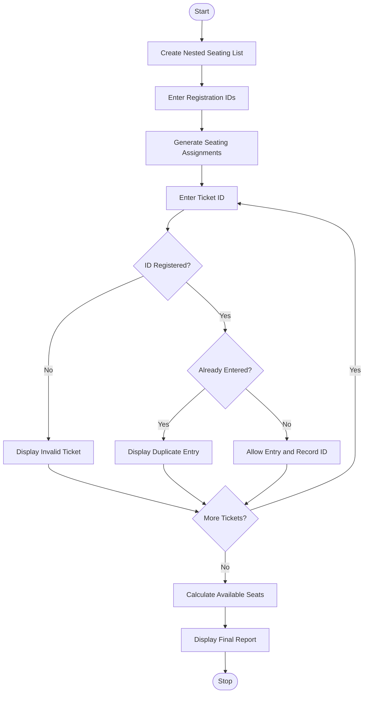

## Campus Event Seating and Entry Validation

### 1. Problem Statement

Develop a Python program to manage campus event seating and entry validation. Generate seating assignments using nested lists, validate tickets using registration IDs, detect duplicate entries, and calculate the available seating capacity.

### 2. Algorithm

1. Start the program.
2. Create a nested list representing rows and seats.
3. Accept the total number of registrations.
4. Generate seating assignments for registered students.
5. Accept ticket registration IDs for entry.
6. Check whether each ID exists in the registration list.
7. Detect duplicate entries using a set.
8. Display valid and invalid entries.
9. Calculate occupied and available seats.
10. Display the final seating report.
11. Stop the program.

### 3. Flowchart (Mermaid)


### 5. Sample Input

```
Enter number of ticket entries: 5
Enter Registration ID: 101
Enter Registration ID: 102
Enter Registration ID: 101
Enter Registration ID: 110
Enter Registration ID: 103
```

### 6. Sample Output

```
Seating Assignments:
['101', '102', '103', '104']
['105', '106', '107', '108']
[0, 0, 0, 0]

Entry Allowed
Entry Allowed
Duplicate Entry
Invalid Ticket
Entry Allowed

--- Event Report ---
Valid Entries: 3
Invalid Tickets: 1
Duplicate Entries: 1
Total Seating Capacity: 12
Occupied Seats: 8
Available Seats: 4
```

Note: This is a basic BTech first-year Python program using nested lists, loops, conditional statements, and sets.
