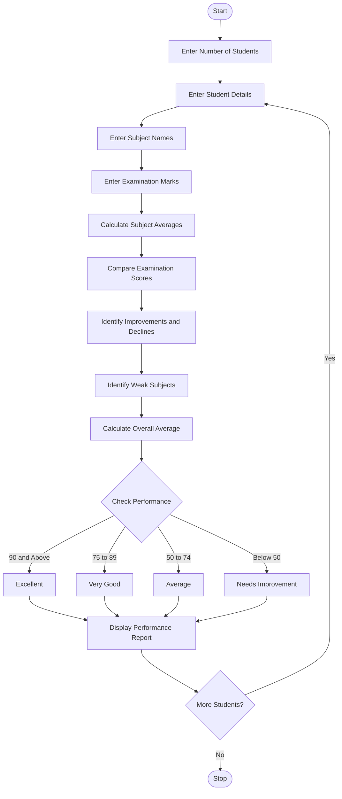

### 1. Problem Statement

Develop a Python program to analyze student performance across multiple examinations. Calculate subject-wise average scores, compare assessment marks to identify improvements and declines, detect consistently weak subjects, and classify students based on their overall performance using specified criteria. Generate a final performance report for each student.

### 2. Algorithm

1. Start the program.
2. Enter the number of students.
3. Enter the student name and number of subjects.
4. Enter subject names.
5. Enter marks obtained in multiple examinations.
6. Calculate the average marks for each subject.
7. Compare marks across examinations.
8. Identify improvements and declines in marks.
9. Detect consistently weak subjects.
10. Calculate the overall average score.
11. Classify students based on performance criteria.
12. Display the student performance report.
13. Repeat for all students.
14. Stop the program.

### 3. Flowchart (Mermaid)

### 5. Sample Input

```
Enter number of students: 1

Student 1
Enter student name: Ravi
Enter number of subjects: 2

Enter subject name: Python
Enter Exam 1 marks: 60
Enter Exam 2 marks: 75
Enter Exam 3 marks: 85

Enter subject name: Maths
Enter Exam 1 marks: 30
Enter Exam 2 marks: 35
Enter Exam 3 marks: 38
```

### 6. Sample Output

```
Student 1

Subject Average: 73.33
Performance: Improved

Subject Average: 34.33
Performance: Improved
Weak Subject: Maths

--- Student Performance Report ---
Student Name: Ravi
Overall Average: 53.83
Weak Subjects: 1
Classification: Average

Performance Analysis Completed
```

