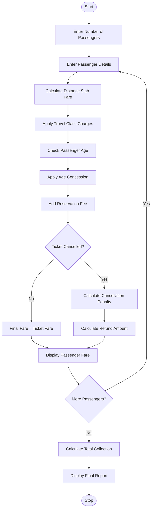

### 1. Problem Statement

Develop a Python program to calculate railway fares for multiple passengers based on distance slabs, travel classes, age-based concessions, reservation fees, and cancellation penalties. Calculate the total ticket fare for each passenger and display the final amount after applying the specified charges and concessions.

### 2. Algorithm

1. Start the program.
2. Read the number of passengers.
3. Enter passenger name, age, distance, and travel class.
4. Calculate the basic fare based on distance slabs.
5. Apply the fare multiplier according to travel class.
6. Apply age-based concessions for eligible passengers.
7. Add reservation fees.
8. Ask whether the ticket is cancelled.
9. If cancelled, calculate the cancellation penalty.
10. Display the final fare for each passenger.
11. Calculate and display the total railway collection.
12. Stop the program.

### 3. Flowchart (Mermaid)


### 5. Sample Input

```
Enter number of passengers: 2

Passenger 1
Enter passenger name: Ravi
Enter age: 25
Enter journey distance: 200
Select travel class: 1
Cancel ticket? (yes/no): no

Passenger 2
Enter passenger name: Sita
Enter age: 65
Enter journey distance: 300
Select travel class: 2
Cancel ticket? (yes/no): yes
```

### 6. Sample Output

```
Passenger 1
Ticket Fare: 500.0
Final Fare: 500.0

Passenger 2
Ticket Fare: 950.0
Cancellation Penalty: 190.0
Refund Amount: 760.0

--- Railway Report ---
Total Railway Collection: 690.0
```

