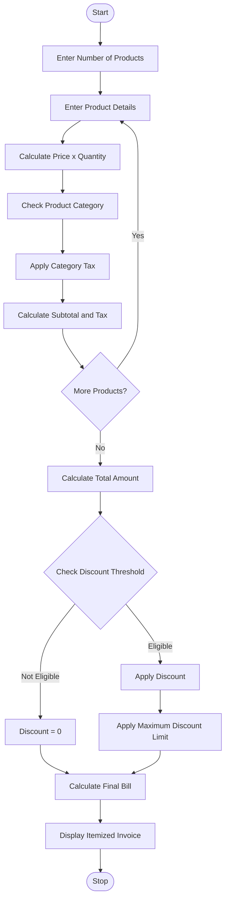

## Retail Billing with Multiple Discount Rules

### 1. Problem Statement

Develop a Python program to generate a retail bill for multiple products. Calculate product-wise prices based on quantities, apply category-specific taxes, provide discounts based on purchase amount, and enforce maximum discount limits. Finally, generate an itemized invoice showing the total amount, discount, tax, and final bill.

### 2. Algorithm

1. Start the program.
2. Enter the number of products.
3. Enter product name, category, price, and quantity.
4. Calculate the subtotal for each product.
5. Apply category-specific tax rates.
6. Calculate the total purchase amount.
7. Check the discount eligibility based on purchase thresholds.
8. Apply the discount and maximum concession limit.
9. Calculate the final bill amount.
10. Display the itemized invoice.
11. Stop the program.

### 3. Flowchart (Mermaid)

### 5. Sample Input

```
Enter number of products: 3

Product 1
Enter product name: Rice
Enter category: food
Enter price: 100
Enter quantity: 5

Product 2
Enter product name: Shirt
Enter category: clothing
Enter price: 500
Enter quantity: 3

Product 3
Enter product name: Laptop
Enter category: electronics
Enter price: 2000
Enter quantity: 1
```

### 6. Sample Output

```
Product Amount: 500.0
Tax: 25.0

Product Amount: 1500.0
Tax: 75.0

Product Amount: 2000.0
Tax: 360.0

======= FINAL INVOICE =======
Subtotal: 4000.0
Total Tax: 460.0
Discount: 400.0
Final Bill: 4060.0
=============================
```

Note: Tax rates, discount percentages, and maximum concession are assumed values for this academic Python program. Actual retail taxes may differ by product and applicable tax rules.
