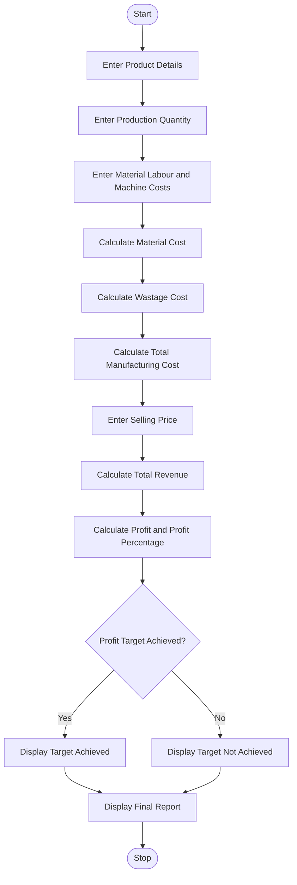

## Manufacturing Cost and Profitability Analysis

### 1. Problem Statement

Develop a Python program to calculate manufacturing costs and analyze product profitability. Calculate material costs, labour charges, wastage costs, and machine costs. Determine the total production cost, selling price, profit, and profit percentage. Finally, identify whether the production meets the specified profit target.

### 2. Algorithm

1. Start the program.
2. Enter the number of products manufactured.
3. Enter product name and production quantity.
4. Enter material cost per unit.
5. Enter labour charges per unit.
6. Enter wastage percentage.
7. Enter machine cost per unit.
8. Calculate material cost and wastage cost.
9. Calculate total manufacturing cost.
10. Enter selling price per unit.
11. Calculate total revenue and profit.
12. Calculate profit percentage.
13. Compare profit percentage with the specified profit target.
14. Display the production cost and profitability report.
15. Stop the program.

### 3. Flowchart (Mermaid)

### 5. Sample Input
Enter number of products: 1

Product 1
Enter product name: Chair
Enter production quantity: 100
Enter material cost per unit: 200
Enter labour cost per unit: 50
Enter wastage percentage: 10
Enter machine cost per unit: 30
Enter selling price per unit: 350
Enter profit target percentage: 15
```

### 6. Sample Output

```
--- Production Report ---
Product Name: Chair
Material Cost: 20000.0
Labour Cost: 5000.0
Wastage Cost: 2000.0
Machine Cost: 3000.0
Total Manufacturing Cost: 30000.0
Total Revenue: 35000.0
Profit: 5000.0
Profit Percentage: 16.67 %

Result: Profit Target Achieved
```

Note: All cost values and wastage percentages are assumed for this basic BTech first-year Python assignment. Profit percentage is calculated based on total manufacturing cost.
