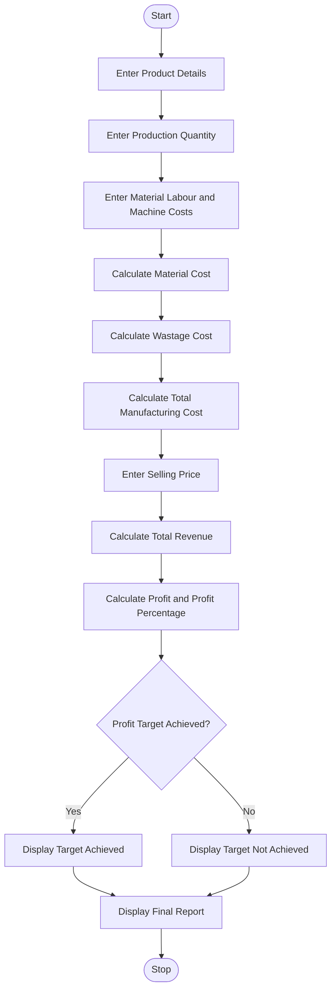

### 1. Problem Statement

Develop a Python program to calculate students' current attendance percentages and determine the minimum number of consecutive classes required to reach a specified attendance eligibility threshold. Consider different future attendance scenarios, such as attending all upcoming classes or missing some classes. Display the current attendance percentage, required classes, and eligibility status.

### 2. Algorithm

1. Start the program.
2. Enter the number of students.
3. Enter each student's name, attended classes, and total classes.
4. Calculate the current attendance percentage.
5. Enter the required eligibility percentage.
6. Calculate the minimum consecutive classes required to reach the threshold.
7. Consider different future attendance scenarios.
8. Check whether the student meets the eligibility criteria.
9. Display the attendance recovery report.
10. Repeat for all students.
11. Stop the program.

### 3. Flowchart (Mermaid)

### 5. Sample Input

```
Enter number of students: 1

Student 1
Enter student name: Ravi
Enter attended classes: 60
Enter total classes: 80
Enter eligibility percentage: 75
```

### 6. Sample Output

```
Current Attendance: 75.0 %
Student is already eligible
Classes required: 0

Future Attendance Scenarios

100 % attendance scenario: 77.78 %
Eligibility: Achieved

80 % attendance scenario: 75.56 %
Eligibility: Achieved

50 % attendance scenario: 72.22 %
Eligibility: Not Achieved
```

