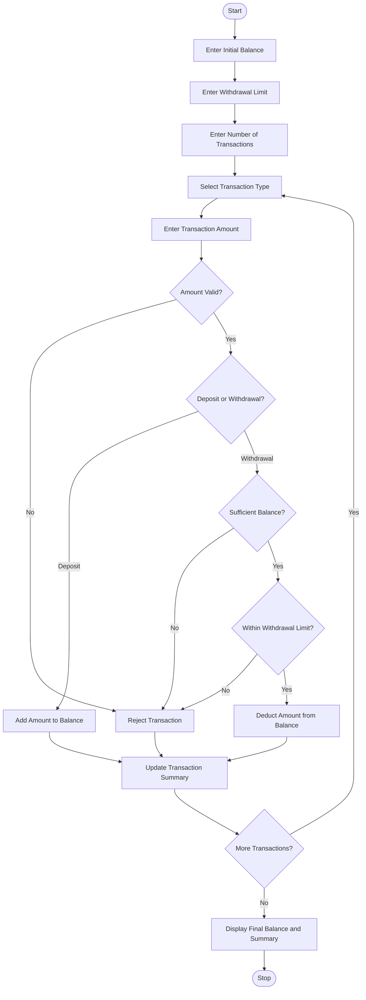

## ATM Transaction Sequence Simulation

### 1. Problem Statement

Develop a Python program to simulate ATM transactions by processing multiple deposits and withdrawals. Maintain the account balance after every transaction, enforce daily withdrawal limits, reject invalid transactions such as insufficient balance or negative amounts, and generate a final transaction summary showing total deposits, withdrawals, rejected transactions, and available balance.

### 2. Algorithm

1. Start the program.
2. Enter the initial account balance.
3. Enter the maximum withdrawal limit.
4. Enter the number of transactions.
5. Select the transaction type (Deposit or Withdrawal).
6. Enter the transaction amount.
7. Check whether the transaction amount is valid.
8. If it is a deposit, add the amount to the balance.
9. If it is a withdrawal, check the available balance and withdrawal limit.
10. Reject transactions that violate the conditions.
11. Update the account balance after every valid transaction.
12. Display the transaction summary.
13. Stop the program.

### 3. Flowchart (Mermaid)

### 5. Sample Input

```
Enter initial balance: 10000
Enter daily withdrawal limit: 5000
Enter number of transactions: 4

1. Deposit
2. Withdrawal
Select transaction type: 1
Enter transaction amount: 2000

1. Deposit
2. Withdrawal
Select transaction type: 2
Enter transaction amount: 3000

1. Deposit
2. Withdrawal
Select transaction type: 2
Enter transaction amount: 4000

1. Deposit
2. Withdrawal
Select transaction type: 2
Enter transaction amount: 1000
```

### 6. Sample Output

```
Deposit Successful
Current Balance: 12000.0

Withdrawal Successful
Current Balance: 9000.0

Daily Withdrawal Limit Exceeded
Current Balance: 9000.0

Withdrawal Successful
Current Balance: 8000.0

--- ATM Transaction Summary ---
Total Deposits: 2000.0
Total Withdrawals: 4000.0
Rejected Transactions: 1
Final Account Balance: 8000.0
Daily Withdrawal Limit: 5000.0
Remaining Withdrawal Limit: 1000.0
```

Note: The initial balance, withdrawal limit, and transaction amounts are assumed values for this basic BTech first-year Python assignment. The withdrawal limit applies to the total successful withdrawals during the simulated day.
