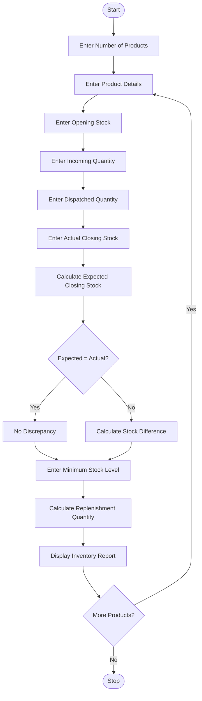

### 1. Problem Statement

Develop a Python program to perform warehouse inventory reconciliation for multiple products. Compare opening stock, incoming quantities, dispatched quantities, and actual closing stock. Identify stock discrepancies, calculate expected closing stock, and determine the replenishment quantity required to maintain the minimum stock level.

### 2. Algorithm

1. Start the program.
2. Enter the number of products.
3. Enter product name and opening stock.
4. Enter incoming stock quantity.
5. Enter dispatched stock quantity.
6. Enter actual closing stock.
7. Calculate expected closing stock.
8. Compare expected and actual closing stock.
9. Identify stock discrepancies.
10. Enter the minimum stock level.
11. Calculate the replenishment requirement.
12. Display the inventory reconciliation report.
13. Repeat for all products.
14. Stop the program.

### 3. Flowchart (Mermaid)

### 5. Sample Input

```
Enter number of products: 2

Product 1
Enter product name: Laptop
Enter opening stock: 50
Enter incoming quantity: 20
Enter dispatched quantity: 30
Enter actual closing stock: 35
Enter minimum stock level: 50

Product 2
Enter product name: Keyboard
Enter opening stock: 100
Enter incoming quantity: 50
Enter dispatched quantity: 40
Enter actual closing stock: 110
Enter minimum stock level: 80
```

### 6. Sample Output

```
--- Inventory Report ---
Product Name: Laptop
Opening Stock: 50
Incoming Stock: 20
Dispatched Stock: 30
Expected Closing Stock: 40
Actual Closing Stock: 35
Stock Status: Stock Shortage
Missing Quantity: 5
Replenishment Required: 15

--- Inventory Report ---
Product Name: Keyboard
Opening Stock: 100
Incoming Stock: 50
Dispatched Stock: 40
Expected Closing Stock: 110
Actual Closing Stock: 110
Stock Status: No Discrepancy
Replenishment Required: 0

Inventory Reconciliation Completed
```

