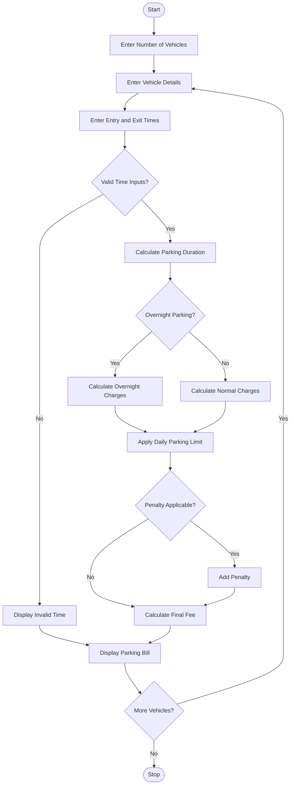

### 1. Problem Statement

Develop a Python program to manage parking fees by calculating charges based on vehicle entry and exit times. Consider different vehicle categories, overnight parking, daily parking limits, and penalty conditions. Validate time inputs and generate a final parking bill showing parking duration, applicable charges, penalties, and total amount.

### 2. Algorithm

1. Start the program.
2. Enter the number of vehicles.
3. Enter vehicle number and vehicle category.
4. Enter parking entry time and exit time.
5. Validate the time inputs.
6. Calculate the total parking duration.
7. Check whether overnight parking is applicable.
8. Calculate parking charges based on vehicle category.
9. Apply the daily maximum parking limit.
10. Check for penalty conditions.
11. Calculate the final parking fee.
12. Display the parking bill for each vehicle.
13. Repeat for all vehicles.
14. Stop the program.

### 3. Flowchart (Mermaid)

### 5. Sample Input

```
Enter number of vehicles: 2

Vehicle 1
Enter vehicle number: AP39AB1234
Enter category (bike/car/bus): car
Enter entry time (HH:MM): 09:00
Enter exit time (HH:MM): 13:00

Vehicle 2
Enter vehicle number: AP39CD5678
Enter category (bike/car/bus): bike
Enter entry time (HH:MM): 22:00
Enter exit time (HH:MM): 06:00
```

### 6. Sample Output

```
--- Parking Bill ---
Vehicle Number: AP39AB1234
Vehicle Category: car
Parking Duration: 4.0 hours
Parking Fee: 80
Overnight Penalty: 0
Total Parking Fee: 80

--- Parking Bill ---
Vehicle Number: AP39CD5678
Vehicle Category: bike
Parking Duration: 8.0 hours
Parking Fee: 80
Overnight Penalty: 50
Total Parking Fee: 130

--- Parking Summary ---
Total Vehicles: 2
Total Collection: 210
```

