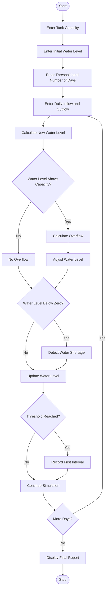

## Multi-Day Water Tank Simulation

### 1. Problem Statement

Develop a Python program to simulate water tank levels over multiple days. Process changing water inflow and outflow quantities, update the water level after each interval, detect overflow and water shortages, and determine the first interval in which the tank reaches a specified water-level threshold. Finally, display a complete water tank monitoring report.

### 2. Algorithm

1. Start the program.
2. Enter the tank capacity.
3. Enter the initial water level.
4. Enter the required water-level threshold.
5. Enter the number of days.
6. For each day, enter the inflow and outflow quantities.
7. Calculate the new water level.
8. Check whether the water level exceeds tank capacity.
9. Detect overflow and adjust the water level.
10. Check whether water shortage occurs.
11. Compare the water level with the specified threshold.
12. Record the first interval in which the threshold is reached.
13. Display daily water levels, overflow, shortages, and final status.
14. Stop the program.

### 3. Flowchart (Mermaid)

### 5. Sample Input

```
Enter tank capacity: 1000
Enter initial water level: 500
Enter water level threshold: 800
Enter number of days: 4

Day 1
Enter water inflow: 200
Enter water outflow: 100

Day 2
Enter water inflow: 300
Enter water outflow: 50

Day 3
Enter water inflow: 400
Enter water outflow: 100

Day 4
Enter water inflow: 100
Enter water outflow: 200
```

### 6. Sample Output

```
Day 1
Current Water Level: 600.0
Overflow Quantity: 0
Shortage Quantity: 0

Day 2
Current Water Level: 850.0
Overflow Quantity: 0
Shortage Quantity: 0

Day 3
Current Water Level: 1000.0
Overflow Quantity: 150.0
Shortage Quantity: 0

Day 4
Current Water Level: 900.0
Overflow Quantity: 0
Shortage Quantity: 0

--- Water Tank Report ---
Final Water Level: 900.0
Overflow Occurrences: 1
Shortage Occurrences: 0
First Threshold Reached: Day 2
Simulation Completed
```

Note: Tank capacity, initial water level, and daily inflow/outflow values are assumed for this basic BTech first-year Python assignment. The program assumes excess water is lost during overflow and shortages are recorded when demand exceeds available water.
